<p align="center">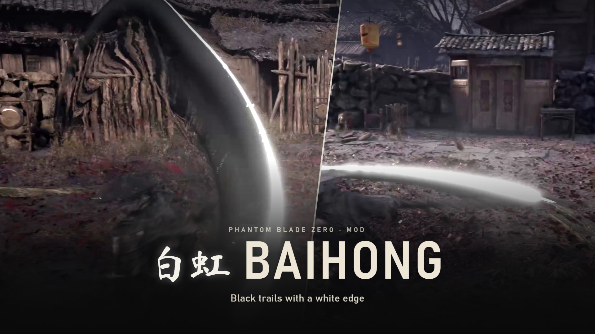</p>

<p align="center">
  <a href="https://www.nexusmods.com/phantombladezero/mods/775"></a>
  <a href="https://github.com/ayokiru/pbz-baihong/releases/latest"></a>
  
  <a href="https://github.com/ayokiru/pbz-bladesmith"></a>
  <a href="LICENSE"></a>
</p>

<p align="center">
  <a href="#what-it-looks-like">Screenshots</a> &nbsp;·&nbsp;
  <a href="#what-changes">What changes</a> &nbsp;·&nbsp;
  <a href="#install">Install</a> &nbsp;·&nbsp;
  <a href="#with-other-mods">With other mods</a> &nbsp;·&nbsp;
  <a href="#build-it-yourself">Build it yourself</a>
</p>

Baihong gives almost every weapon in Phantom Blade Zero the same swing trail: a black ribbon with a thin white edge. The blades turn grey to match. Stats, movesets and hitboxes stay the same.

## What it looks like

<table>
  <tr>
    <td width="50%">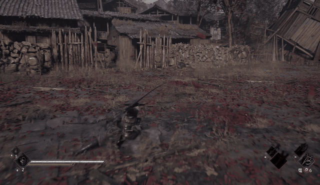</td>
    <td width="50%">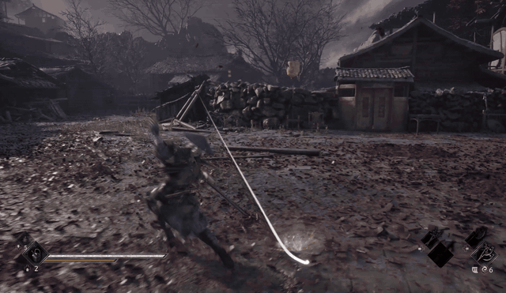</td>
  </tr>
  <tr>
    <td align="center"><sub>Overhead swings</sub></td>
    <td align="center"><sub>Sideways swings</sub></td>
  </tr>
  <tr>
    <td width="50%">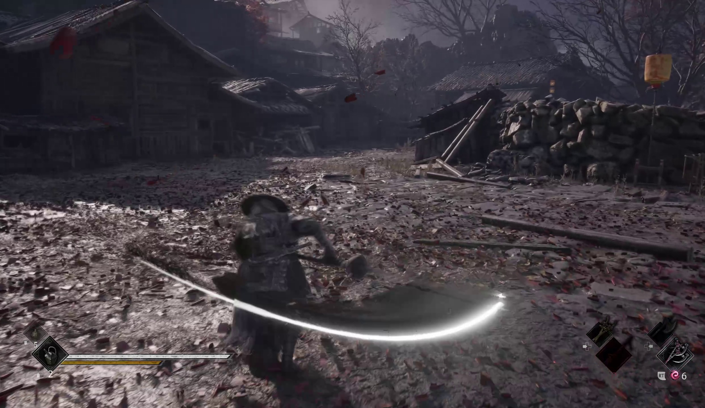</td>
    <td width="50%">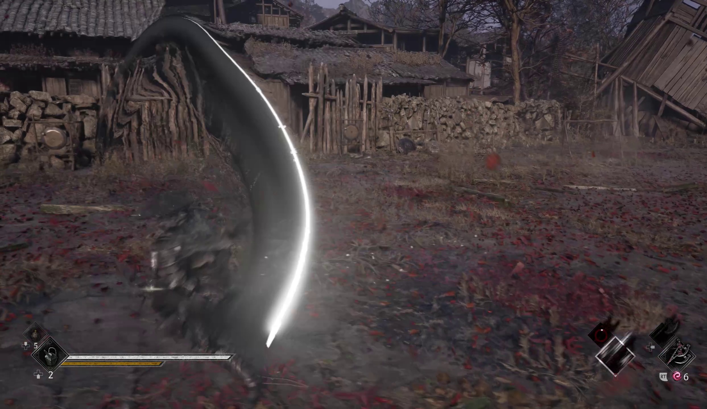</td>
  </tr>
  <tr>
    <td width="50%">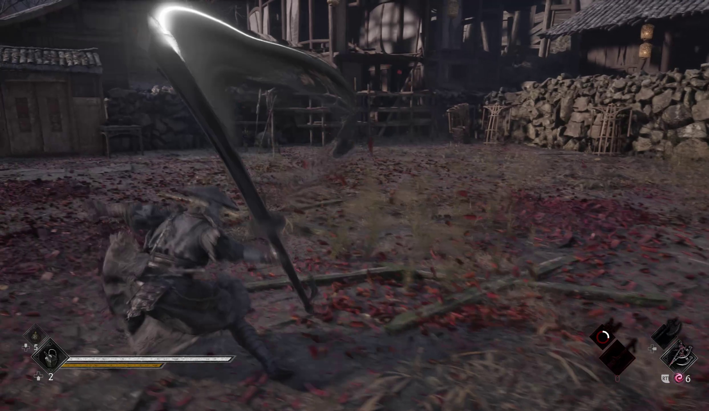</td>
    <td width="50%">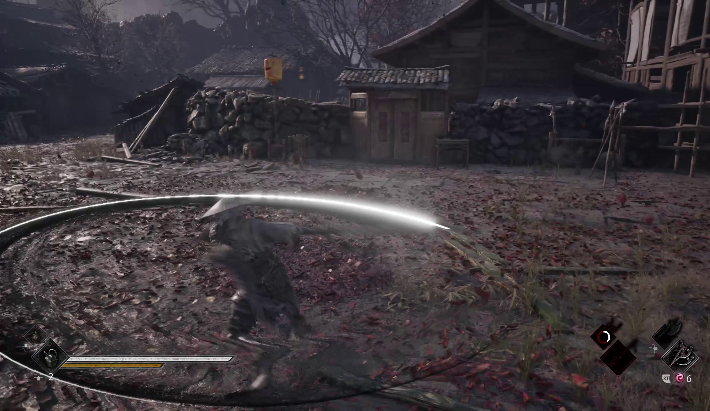</td>
  </tr>
  <tr>
    <td width="50%">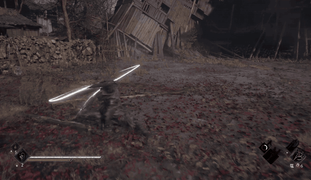</td>
    <td width="50%">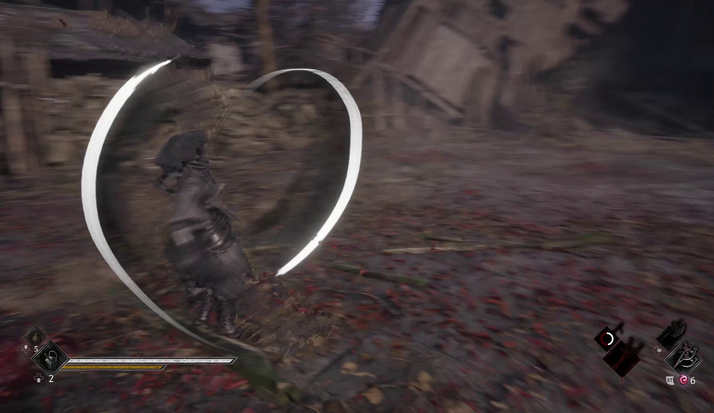</td>
  </tr>
  <tr>
    <td align="center"><sub>Dual blades</sub></td>
    <td></td>
  </tr>
  <tr>
    <td width="50%">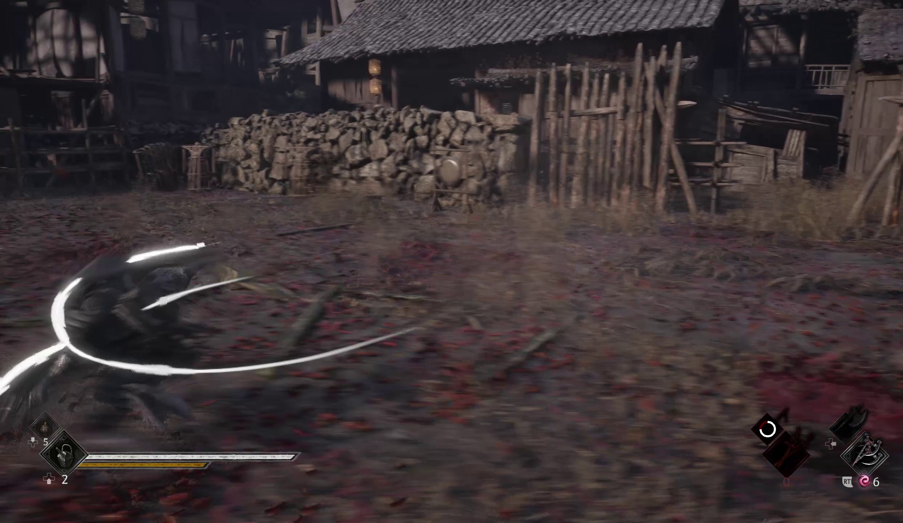</td>
    <td width="50%">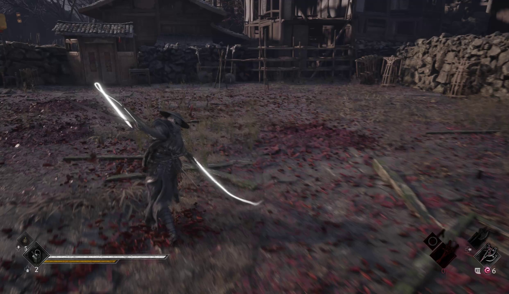</td>
  </tr>
</table>

## What changes

Every swing uses the Wild Oriole Sword's trail, recolored: the main ribbon is black and the leading edge white. Light attacks get the light version of the trail, heavy and charged attacks the heavy one.

Blades, hilts and guards are recolored grey, so the engraving and the wear still show. Kicks and the dodge keep their own look.

A few things work differently:

- The Sanguine Twin gets grey blades but no trails. The game draws none for it, and turning them on crashes the game when you draw the blades.
- The Lady's Fan gets the trails, but its blade keeps its colors. The blade is an effect, not a model, so there's no material to recolor.
- The equipment menu still shows each weapon's original look. You see the change once the weapon is in your hands.

## Install

1. Download [Baihong_1.0.zip](https://github.com/ayokiru/pbz-baihong/releases/latest/download/Baihong_1.0.zip).
2. Unpack it into the game folder, the one that has `ProjectPBZ` in it. The files land in `ProjectPBZ\Content\Paks\~mods`.
3. Start the game.

To remove it, delete `zzz_zBaihong_P.pak`, `.ucas` and `.utoc` from `~mods`.

If you only want some weapons, every weapon also has its own zip in the [release](https://github.com/ayokiru/pbz-baihong/releases/latest), named after the weapon. Install those instead of the main file.

To keep every weapon's own look and get only the trails, install [Baihong_TrailsOnly_1.0.zip](https://github.com/ayokiru/pbz-baihong/releases/latest/download/Baihong_TrailsOnly_1.0.zip) instead of the main file. The blades stay as they are in the game, with no grey recolor. The same zip has a `Per weapon` folder too: to get the trails on only some weapons, copy their folders' files into `~mods` instead of the whole thing.

## With other mods

When two paks change the same weapon, the game uses the one whose name sorts first, and capital letters sort before small ones. Baihong's pak starts with `zzz_z`, so a mod that changes a weapon wins on that weapon and Baihong covers the rest.

[Mohen](https://github.com/ayokiru/pbz-mohen) changes the same weapons. With both installed, Baihong wins on every weapon. To mix them, take the per-weapon zips of each.

## Build it yourself

The pak is a [Bladesmith](https://github.com/ayokiru/pbz-bladesmith) build from your own copy of the game, so after a game patch you can rebuild it instead of waiting for an update. [`recipes/baihong.json`](recipes/baihong.json) is the recipe, [`presets/baihong.json`](presets/baihong.json) holds the colors, and [`tools/make_recipe.py`](tools/make_recipe.py) writes the recipe from Bladesmith's weapon list.

```
bladesmith build recipes/baihong.json --install
```

You need a Bladesmith build newer than 0.5.3. The grey blades came after it.

## License

[MIT](LICENSE) for the recipes, presets, scripts, texts and pictures in this repo. Phantom Blade Zero and the game data inside the pak belong to S-GAME.
